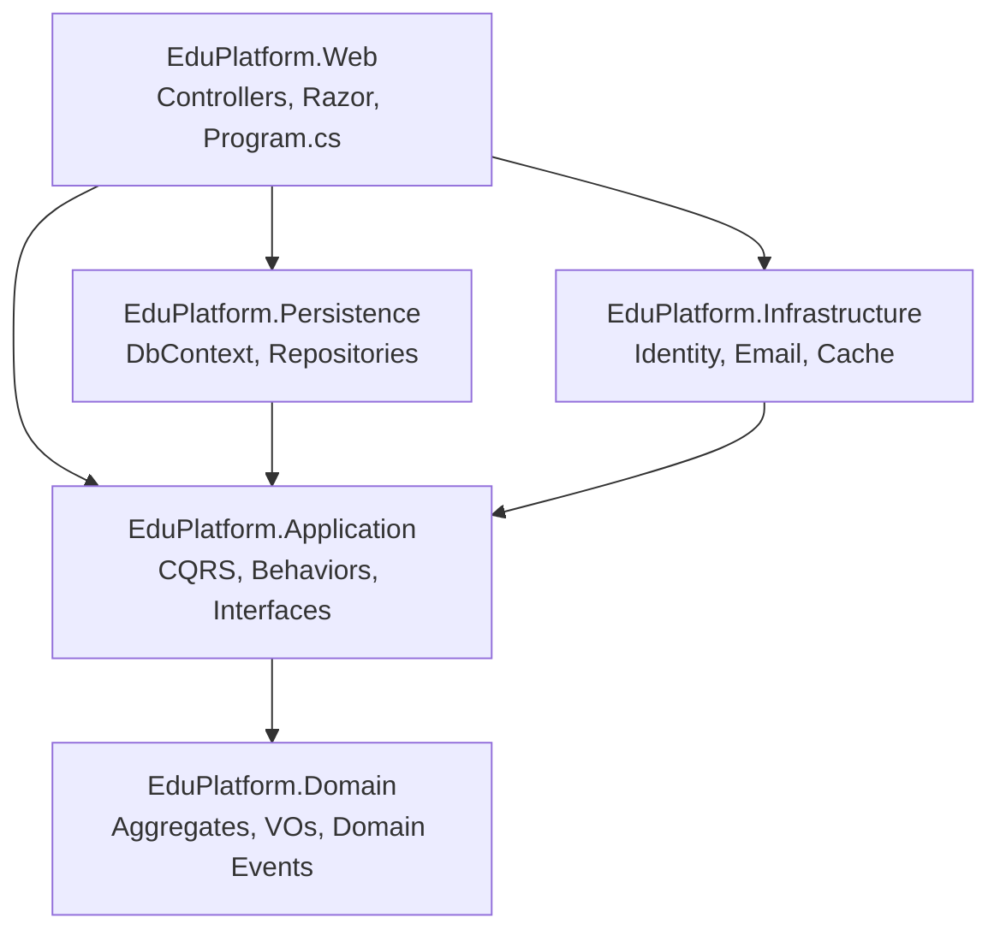

# Chapter 2 — Solution Structure & Clean Architecture

> **Learning goals** — by the end of this chapter you can:
> 1. Read the `.sln` you opened in Ch.01 and explain why each project reference exists (and why some don't).
> 2. Trigger a compiler error that proves the Dependency Rule is enforced at compile time.
> 3. Set up `Directory.Build.props` for shared settings across all projects.
> 4. Choose between Clean Architecture, Vertical Slice, and Modular Monolith for a new project — and defend the choice.

---

## 2.1 The five projects, restated

We re-stated the table from Ch.01 so this chapter is self-contained:

| Project | Target | Role | References |
|---------|--------|------|-----------|
| `EduPlatform.Domain` | `net8.0` (library) | Aggregates, VOs, domain events | *none* |
| `EduPlatform.Application` | `net8.0` (library) | CQRS handlers, interfaces, behaviors | `Domain` |
| `EduPlatform.Persistence` | `net8.0` (library) | EF Core DbContext, repositories, migrations | `Application` |
| `EduPlatform.Infrastructure` | `net8.0` (library) | Identity, email, cache, payment clients | `Application` |
| `EduPlatform.Web` | `net8.0` (web) | Composition root: DI, controllers, Razor | `Application`, `Persistence`, `Infrastructure` |

Test projects:
- `EduPlatform.UnitTests` references `Application` and `Domain`.
- `EduPlatform.IntegrationTests` references `Web` (so `WebApplicationFactory<Program>` can spin the host) and `Persistence`.

> **Architect's note — *Why tests don't reference Web at unit-test level.***
> Unit tests target the Application layer because handlers are pure async functions: input → query the repository abstraction → return DTO. They should not need ASP.NET plumbing. If you find yourself writing `WebApplicationFactory` in a *unit* test, you are actually writing an integration test — move it across.

---

## 2.2 The Dependency Rule, mechanically

> *"The Dependency Rule says that source code dependencies can only point inwards. …Nothing in an inner circle can know anything at all about something in an outer circle."* — Robert C. Martin, *Clean Architecture* (2017), chapter 22.

What does this mean in C#? It means **project references may not point outward**. Concretely:

```
Domain        → references NOBODY
Application   → references Domain only
Persistence   → references Application (which gives it Domain transitively)
Infrastructure→ references Application only (NOT Persistence)
Web           → references Application, Persistence, Infrastructure
```

If you try to add `using Microsoft.EntityFrameworkCore;` in `EduPlatform.Domain`, the compiler stops you — `Domain` has no `PackageReference` to EF Core. This is the enforcement we want: it makes architectural violations visible at compile time, not in code review.

Try it. Open `EduPlatform.Domain/Course.cs` (we'll write it in Ch.03; for now create a stub) and add:

```csharp
using Microsoft.EntityFrameworkCore; // WILL NOT COMPILE
namespace EduPlatform.Domain.Entities;
public class Course { }
```

You'll see `CS0234: The type or namespace name 'EntityFrameworkCore' does not exist in the namespace 'Microsoft'`. *That* is the architecture working. Fix it by moving the EF dependency to `Persistence`.

> **Architect's note — *Compile-time enforcement > documentation.***
> Documentation drifts. Conventions get violated on Friday afternoons. Compiler errors don't. The reason we invest in five projects instead of one giant project is so that *mistakes are caught by the compiler*, not by a six-month-later code review.

---

## 2.3 The dependency graph as a Mermaid diagram

```
            ┌────────────┐
            │   Domain   │   (no project refs)
            └─────┬──────┘
                  │
            ┌─────▼──────────┐
            │  Application   │   (CQRS, interfaces, behaviors)
            └──┬──────────┬──┘
               │          │
   ┌───────────▼┐        ┌▼──────────────┐
   │Persistence │        │Infrastructure │   (both reference Application,
   └─────┬──────┘        └────┬──────────┘    never each other)
         │                    │
         └────────┬───────────┘
                  │
            ┌─────▼──────┐
            │    Web     │   (composition root)
            └───────────┘
```

Rendered as Mermaid for the `/diagrams/architecture.mmd` file:



Save this as `diagrams/architecture.mmd` (it's already in your ZIP).

---

## 2.4 `Directory.Build.props` — shared settings

In a multi-project solution you want consistent compiler settings (nullable on, treat warnings as errors, LangVersion). Put them once in a `Directory.Build.props` at the solution root and MSBuild auto-applies them to every project underneath.

```xml
<!-- starter-solution/Directory.Build.props -->
<Project>
  <PropertyGroup>
    <TargetFramework>net8.0</TargetFramework>
    <LangVersion>latest</LangVersion>
    <Nullable>enable</Nullable>
    <ImplicitUsings>enable</ImplicitUsings>
    <TreatWarningsAsErrors>true</TreatWarningsAsErrors>
    <GenerateDocumentationFile>true</GenerateDocumentationFile>
    <NoWarn>$(NoWarn);CS1591</NoWarn>
  </PropertyGroup>
</Project>
```

After this exists, individual `.csproj` files only need to declare *differences* (e.g., `<Project Sdk="Microsoft.NET.Sdk.Web">` for the web project, or `<IsTestProject>true</IsTestProject>` for tests).

> **Architect's note — *`TreatWarningsAsErrors` in tutorials.***
> A tutorial with `TreatWarningsAsErrors=false` produces code that compiles but nags. The student ignores the nagging — and they get used to a codebase that emits 87 warnings. Forcing `TreatWarningsAsErrors=true` from day one creates a clean-noise baseline; any *new* warning is loud and gets fixed. The cost is one-time friction (a few `#pragma warning disable` lines when you really must) but it pays off in habit formation.

---

## 2.5 Project file by file

We covered `.csproj` files in Ch.01's scaffold. Re-read them now with this lens:

### 2.5.1 `EduPlatform.Domain.csproj`

```xml
<Project Sdk="Microsoft.NET.Sdk">
  <PropertyGroup>
    <TargetFramework>net8.0</TargetFramework>
    <Nullable>enable</Nullable>
    <ImplicitUsings>enable</ImplicitUsings>
    <TreatWarningsAsErrors>true</TreatWarningsAsErrors>
  </PropertyGroup>
  <ItemGroup>
    <PackageReference Include="Ardalis.GuardClauses" Version="4.5.0" />
    <PackageReference Include="MediatR.Contracts" Version="2.0.1" />
  </ItemGroup>
</Project>
```

Two NuGets only. `Ardalis.GuardClauses` for argument guards (`Guard.Against.Null(...)`). `MediatR.Contracts` provides `IRequest`, `INotification` — we need *the contracts* in Domain (so entities can publish domain events via `INotification`) but we don't want the *runtime* (MediatR itself) here.

### 2.5.2 `EduPlatform.Application.csproj`

```xml
<ProjectReference Include="..\EduPlatform.Domain\EduPlatform.Domain.csproj" />
<PackageReference Include="FluentValidation" Version="11.9.0" />
<PackageReference Include="MediatR" Version="12.3.0" />
<PackageReference Include="AutoMapper" Version="13.0.1" />
<PackageReference Include="Ardalis.Specification" Version="8.0.0" />
<PackageReference Include="Ardalis.Result" Version="9.0.0" />
```

This is where the *patterns* live. FluentValidation for validation, MediatR for the pipeline, AutoMapper for DTO ↔ entity mapping, Ardalis.Specification for query encapsulation (more in Ch.7), Ardalis.Result for return values that carry errors without exceptions.

### 2.5.3 `EduPlatform.Persistence.csproj`

```xml
<ProjectReference Include="..\EduPlatform.Application\EduPlatform.Application.csproj" />
<PackageReference Include="Microsoft.EntityFrameworkCore" Version="8.0.2" />
<PackageReference Include="Microsoft.EntityFrameworkCore.SqlServer" Version="8.0.2" />
<PackageReference Include="Microsoft.EntityFrameworkCore.Design" Version="8.0.2">
  <PrivateAssets>all</PrivateAssets>
  <IncludeAssets>runtime; build; native; contentfiles; analyzers; buildtransitive</IncludeAssets>
</PackageReference>
<PackageReference Include="Bogus" Version="35.4.0" />
```

Note `<PrivateAssets>all</PrivateAssets>` on the EF Core *Design* package: this is a build-time-only dependency (for `dotnet ef migrations`). We don't want to publish it.

### 2.5.4 `EduPlatform.Infrastructure.csproj`

```xml
<ProjectReference Include="..\EduPlatform.Application\EduPlatform.Application.csproj" />
<PackageReference Include="Microsoft.AspNetCore.Identity.EntityFrameworkCore" Version="8.0.2" />
<PackageReference Include="Serilog.AspNetCore" Version="8.0.1" />
<PackageReference Include="Serilog.Sinks.MSSqlServer" Version="6.5.1" />
<PackageReference Include="Microsoft.Extensions.Caching.SqlServer" Version="8.0.2" />
<PackageReference Include="Polly" Version="8.3.0" />
```

Identity, Serilog, distributed cache, retry policies. Note: this project does *not* reference Persistence — the rule is they share Application but never each other.

### 2.5.5 `EduPlatform.Web.csproj`

```xml
<Project Sdk="Microsoft.NET.Sdk.Web">
  <ItemGroup>
    <ProjectReference Include="..\EduPlatform.Application\EduPlatform.Application.csproj" />
    <ProjectReference Include="..\EduPlatform.Persistence\EduPlatform.Persistence.csproj" />
    <ProjectReference Include="..\EduPlatform.Infrastructure\EduPlatform.Infrastructure.csproj" />
  </ItemGroup>
  <PackageReference Include="Microsoft.EntityFrameworkCore.Design" Version="8.0.2" />
  <!-- ... -->
</Project>
```

`Sdk="Microsoft.NET.Sdk.Web"` is what makes ASP.NET Core app settings, wwwroot, and Razor compile-on-publish available. Web is the only project with that Sdk.

---

## 2.6 Why three architecture styles exist — and why we picked Clean Arch here

You will hear developers debate architecture constantly. The three realistic options for a .NET web app today:

### 2.6.1 Clean Architecture (what we use)

**Shape:** layered by *concern* (domain/application/infrastructure), strict inward dependency rule.

**Wins:**
- Architectural rules enforced at compile time.
- Domain entities stay pure C# — no EF attributes, no ASP.NET attributes.
- Easy to unit test Application layer in isolation (no HTTP plumbing).
- Familiar to most .NET teams.

**Costs:**
- More files per feature (a 5-step course creation = 5 entity + 5 handler + 5 DTO + 5 mapping).
- Indirection through interfaces can obscure "where does this code actually go".
- New developers have a learning curve.

### 2.6.2 Vertical Slice Architecture

**Shape:** organized by *feature* (`/Courses`, `/Reviews`, `/Enrollment`), each folder containing its controller, handler, entity, view.

**Wins:**
- Lower file count per feature; easier to scan.
- Reorganizing features is trivial — move a folder.
- No "where does this go?" question.

**Costs:**
- Cross-feature invariants (e.g., "every review must belong to an enrolled student") get spread across folders.
- Architectural rules must be enforced with conventions, not the compiler.
- Harder to enforce "no EF in Domain".

### 2.6.3 Modular Monolith

**Shape:** multiple ASP.NET Core modules, each with its own DbContext, communicating via in-process messages (MediatR notifications or MassTransit).

**Wins:**
- Real DDD bounded contexts.
- Easy to spin out into microservices later.
- Strong module boundaries.

**Costs:**
- Operational overhead (multiple DbContexts, multiple migrations, eventual consistency).
- Overkill for an LMS at this scale.
- Significant team discipline required.

### Our choice: Clean Architecture

We picked Clean Architecture because:
1. **Teaching artifact** — the layered pattern *shows* the patterns. Vertical Slice hides them in folders.
2. **Feature scale** — six modules across ~30 entities is medium-sized; Clean Arch scales comfortably here.
3. **Team familiarity** — most .NET engineers have seen Clean Arch; Vertical Slice is a more recent fashion.

If we were building *the actual Udemy* at scale, **Modular Monolith** would be the right starting point. If we were building a *prototype* or hackathon, **Vertical Slice** would win. There is no universally correct answer — and any senior architect who tells you otherwise is selling something.

> **Architect's note — *Architecture is reversible; data is not.***
> You can refactor Clean Arch → Vertical Slice in a quarter if you're wrong. You can refactor Vertical Slice → Modular Monolith in a year. But if you mis-design the *database*, you're stuck for a decade. Spend 10× more time on the data model (Ch.04) than on the architecture pattern.

---

## 2.7 The composition root — `Program.cs`

`Program.cs` in the `Web` project is where everything is wired. We'll cover the full file in Ch.05/Ch.06, but for now understand that **only the Web project is allowed to know all the implementations**. This is the *composition root* pattern (Mark Seemann, *Dependency Injection Principles, Practices, and Patterns*, 2019).

Concretely:

```csharp
// Program.cs (in Web)
builder.Services.AddScoped(typeof(IRepository<>), typeof(Repository<>)); // Application interface → Persistence impl
builder.Services.AddMediatR(cfg => cfg.RegisterServicesFromAssembly(typeof(Marker).Assembly));
builder.Services.AddDbContext<ApplicationDbContext>(opts =>
    opts.UseSqlServer(builder.Configuration.GetConnectionString("DefaultConnection")));
```

Note the `IRepository<>` interface lives in `Application`, the `Repository<>` class lives in `Persistence`, and the *binding* between them happens in `Web`. This is what makes the architecture *composable* — you could ship a variant of the product with a different repository implementation (e.g., a Cosmos DB-backed one for one tenant) and only `Program.cs` changes.

> **Architect's note — *Composition root is the only place that "knows everything".***
> The Web project (or a separate `CompositionRoot` project if you're strict) is the *only* assembly allowed to reference every implementation. This keeps the rest of the codebase ignorant of *which* concrete classes are in use at runtime — which is the entire point of dependency injection.

---

## 2.8 Common violation: Persistence ↔ Infrastructure entanglement

You'll be tempted at some point to call `SignInManager<ApplicationUser>` from inside a repository, or to call `IDbContext.SaveChangesAsync()` from inside an email sender. *Don't*. These are two violations of the same rule.

**Violation 1: Repository calling Identity.**

```csharp
// Persistence/Repositories/CourseRepository.cs
public async Task<Course?> GetForInstructorAsync(string userId)
{
    var user = await _userManager.FindByIdAsync(userId); // ❌
    return await _db.Courses.FirstOrDefaultAsync(c => c.InstructorId == user.Id);
}
```

If you see this, it means `Persistence` is reaching into Identity concerns. The fix is: the caller (an Application handler) resolves the user, then passes a known `instructorId` into the repository.

**Violation 2: Email sender calling DbContext.**

```csharp
// Infrastructure/Email/SendGridEmailSender.cs
public async Task SendAsync(string to, string subject, string body)
{
    await _db.Outbox.AddAsync(new OutboxMessage(to, subject, body)); // ❌
    await _sendGrid.SendEmailAsync(to, subject, body);
}
```

If you find yourself writing this, you're conflating *outbox pattern* (Persistence concern) with *email delivery* (Infrastructure concern). The correct split is to put an `IOutboxRepository` interface in `Application`, implement it in `Persistence`, and have the email sender read from the outbox via that interface.

These violations are subtle because the code compiles. The architecture rule says they're wrong because *the seams disappear*. We'll revisit both in Ch.23.

---

## 2.9 Folder structure inside each project

Inside each project we use folders by *concept*, not by *type*. That is, **don't** have `Entities/`, `ValueObjects/`, `DomainEvents/` as top-level — that splits related concepts across folders. Instead:

```
EduPlatform.Domain/
└── Courses/                      ← domain concept
    ├── Course.cs                  (entity)
    ├── CourseSlug.cs              (value object)
    ├── CourseStatus.cs            (enum)
    ├── Lesson.cs                 (entity)
    └── Events/
        ├── CoursePublishedEvent.cs
        └── CourseArchivedEvent.cs
└── Reviews/
    ├── Review.cs
    └── RatingScore.cs
└── Enrollment/
    ├── Enrollment.cs
    └── EnrollmentStatus.cs
└── Common/
    ├── BaseEntity.cs
    └── IDomainEvent.cs
```

This is the **Package by Feature** convention (Robert C. Martin again). When you open a folder, you see everything about a concept in one place.

> **Architect's note — *Folder shape mirrors domain shape.***
> If a new team member can guess where `Review` lives by looking at the domain (i.e., "reviews are part of courses, so let me look in `Courses/`"), your folder structure is correct. If they have to grep, it isn't.

---

## 2.10 Hands-on exercise

> 1. Open the `starter-solution/EduPlatform.sln` we scaffolded in Ch.01.
> 2. Run `dotnet build`. Everything should restore and build (with `CS4014` / `CA1822`-style warnings suppressed).
> 3. Add a `using Microsoft.EntityFrameworkCore;` line to `EduPlatform.Domain/Entities/Course.cs` (a placeholder file is fine). Confirm the compiler rejects it.
> 4. Remove that `using`. Confirm it builds.
> 5. In `notes.md`, write down the *exact error code* (e.g., `CS0234`). This is the architectural boundary, enforced.

---

## 2.11 Further reading

- Robert C. Martin, *Clean Architecture* (2017), chapter 22 — the canonical definition.
- Steve Smith, *Clean Architecture Solution Template (Ardalis)* — github.com/ardalis/CleanArchitecture.
- Mark Seemann, *Dependency Injection Principles, Practices, and Patterns* (2019), chapters 1–4 — composition root.
- Milan Jovanović, *Vertical Slice Architecture* article — milanjovanovic.tech/blogs/vertical-slice-architecture.
- Kamil Grzybek, *Modular Monolith with .NET* — github.com/kgrzybek/modular-monolith-with-ddd.

---

**Next:** *Chapter 3 — Domain Layer Design.* We write the `Course`, `Lesson`, `Review`, `Enrollment`, `Category` aggregates and the value objects that protect their invariants.
