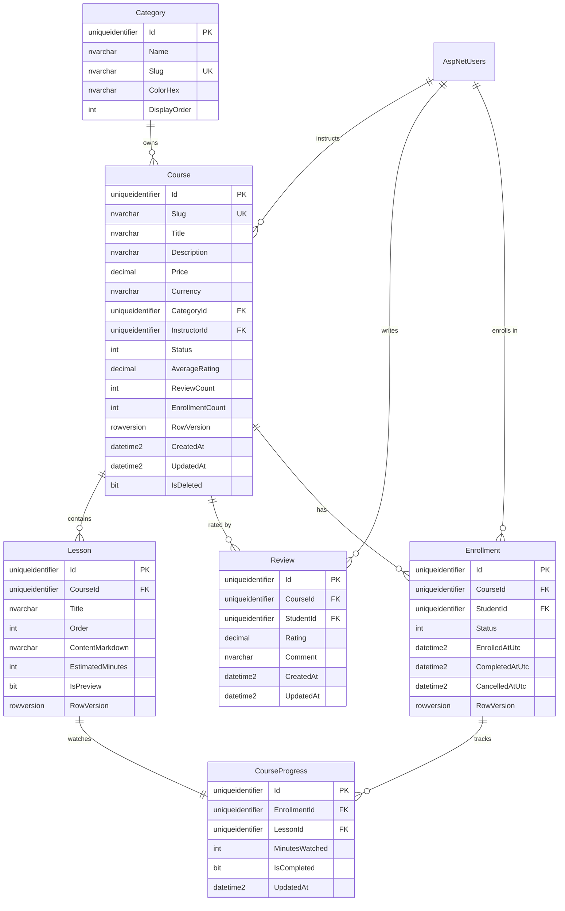

# Chapter 4 — Database Design

> **Learning goals** — by the end of this chapter you can:
> 1. Translate the Domain aggregates from Ch.03 into a normalized SQL Server schema.
> 2. Choose the right indexes for each access pattern (catalog browse, instructor's courses, student's enrollments).
> 3. Decide when to denormalize and when not to.
> 4. Implement audit columns, soft delete, and concurrency tokens consistently across every table.

---

## 4.1 Designing a schema is a series of trade-offs

Database design is mostly about choosing which invariants to violate. You can have full 3NF (every fact lives in exactly one place, no redundancy) — but then every page render requires a 6-table join, and a `Course`'s `AverageRating` is recomputed on every browse. Or you can denormalize for read speed — but then a single review update writes to two tables in a transaction, and a missed transaction means stale data forever.

For an LMS where **reads dwarf writes 100:1**, the right trade-off is: *normalize the source-of-truth tables, denormalize the read models*. We'll do that explicitly with `Course.AverageRating`, `Course.ReviewCount`, and `Course.EnrollmentCount` — *computed* in the Domain (Ch.03), but stored as columns for catalog-browse speed.

> **Architect's note — *Reads/Writes ratio dictates denormalization.***
> A system with 1:1 read/write should be fully normalized. A system with 100:1 read/write should have read-side projections. The mistake is to apply one rule everywhere: an OLTP system over-denormalized turns into a write-orchestration nightmare (every order line update touches five tables); an analytics system over-normalized turns into a query-per-second nightmare. Always know your ratio.

---

## 4.2 The entity-relationship diagram



Save this as `diagrams/erd.mmd` (already in your ZIP).

---

## 4.3 Table-by-table walkthrough

### 4.3.1 `Categories`

| Column | Type | Notes |
|--------|------|-------|
| `Id` | `UNIQUEIDENTIFIER` PK | default `NEWSEQUENTIALID()` for index density |
| `Name` | `NVARCHAR(100)` NOT NULL | displayed as the chip label |
| `Slug` | `NVARCHAR(50)` NOT NULL | `UNIQUE` — used in URLs (`/category/it-software`) |
| `ColorHex` | `NVARCHAR(7)` NOT NULL | e.g. `#F8BBD0` for pink |
| `DisplayOrder` | `INT` NOT NULL | sort chips left-to-right |

Indexes: clustered on `Id` (default), non-clustered unique on `Slug`. That's it; the table is tiny (5–20 rows in our reference image: All, IT & Software, Media Training, Business, Interior).

### 4.3.2 `Courses`

This is the heaviest table. Columns grouped by concern:

| Concern | Columns | Notes |
|---------|---------|-------|
| Identity | `Id` (PK, `UNIQUEIDENTIFIER`), `RowVersion` (`rowversion`) | `rowversion` enables optimistic concurrency |
| Public identity | `Slug` (UNIQUE non-clustered), `Title`, `Description` | `Slug` is the public URL handle |
| Money | `Price` (`DECIMAL(10,2)`), `Currency` (`CHAR(3)`) | money value object mapped to two columns |
| Foreign keys | `CategoryId`, `InstructorId` | `InstructorId` is `UNIQUEIDENTIFIER` pointing to `AspNetUsers.Id` |
| State | `Status` (`TINYINT`) | `Draft=0, Published=1, Archived=2` |
| Denormalized read | `AverageRating` (`DECIMAL(2,1)`), `ReviewCount` (`INT`), `EnrollmentCount` (`INT`) | refreshed by domain events (Ch.16) and enrollment domain events (Ch.17) |
| Audit / soft delete | `CreatedAt`, `UpdatedAt`, `IsDeleted` | filter `WHERE IsDeleted = 0` on the catalog queries |

Indexes (this matters more than the columns):

| Index | Type | Purpose |
|-------|------|---------|
| `PK_Courses` | Clustered on `Id` | default |
| `UQ_Courses_Slug` | Non-clustered unique on `Slug` | catalog browse by URL |
| `IX_Courses_CategoryId_Status` | Non-clustered on `(CategoryId, Status)` | filter by category + only published |
| `IX_Courses_InstructorId` | Non-clustered on `InstructorId` | instructor portal: "my courses" |
| `IX_Courses_Status_CreatedAt_Desc` | Non-clustered on `(Status, CreatedAt DESC)` | "latest courses" home page |
| `IX_Courses_EnrollmentCount_Desc` | Non-clustered on `(EnrollmentCount DESC) WHERE Status = 1` | filtered index for "most popular" |

The **filtered index** is a SQL Server feature we should use more often: only `Status = 1 (Published)` courses can be browsed, so the index need not cover `Draft` or `Archived` rows. A filtered index on a 1M-row table with 50k published rows is 20× faster on the hot read path.

> **Architect's note — *Index the read pattern, not the data.***
> A common mistake is to add indexes based on the column list ("CategoryId is a foreign key, index it"). The right framing is: "What queries will hit this table?" — list them, then index the columns in the order the query filters. `IX_Courses_CategoryId_Status` is `(CategoryId, Status)` not `(Status, CategoryId)` because the catalog browse always filters by category first, then by status. Index column order must match predicate order.

### 4.3.3 `Lessons`

| Column | Type | Notes |
|--------|------|-------|
| `Id` | `UNIQUEIDENTIFIER` PK | |
| `CourseId` | `UNIQUEIDENTIFIER` FK | non-clustered index |
| `Title` | `NVARCHAR(200)` | |
| `Order` | `INT` | order within course |
| `ContentMarkdown` | `NVARCHAR(MAX)` | markdown source, not HTML |
| `EstimatedMinutes` | `INT` | for the sidebar progress calculation |
| `IsPreview` | `BIT` | free preview, no enrollment required |
| `RowVersion` | `rowversion` | optimistic concurrency |

Indexes: `PK_Lessons` clustered on `Id`, `IX_Lessons_CourseId_Order` non-clustered unique on `(CourseId, Order)` — we want both "list lessons for a course" and "no two lessons share an order in the same course" enforced.

### 4.3.4 `Reviews`

| Column | Type | Notes |
|--------|------|-------|
| `Id` | `UNIQUEIDENTIFIER` PK | |
| `CourseId` | `UNIQUEIDENTIFIER` FK | |
| `StudentId` | `UNIQUEIDENTIFIER` FK → `AspNetUsers.Id` | |
| `Rating` | `DECIMAL(2,1)` | 0.0–5.0, snapped to 0.5 |
| `Comment` | `NVARCHAR(1000)` | |
| `CreatedAt`, `UpdatedAt` | `DATETIME2` | audit |

Indexes:
- `IX_Reviews_CourseId_CreatedAt_Desc` — for "course detail page, latest reviews first"
- `UQ_Reviews_CourseId_StudentId` — **unique constraint**: enforces "one review per student per course" at the database level. *This is the second line of defense*; the Application layer checks first (Ch.16), but the unique index is the safety net.

### 4.3.5 `Enrollments`

| Column | Type | Notes |
|--------|------|-------|
| `Id` | `UNIQUEIDENTIFIER` PK | |
| `CourseId`, `StudentId` | FK | |
| `Status` | `TINYINT` | `None=0, Enrolled=1, InProgress=2, Completed=3, Cancelled=4` |
| `EnrolledAtUtc`, `CompletedAtUtc`, `CancelledAtUtc` | `DATETIME2` NULL | nullable because they aren't set until a state transition occurs |
| `RowVersion` | `rowversion` | critical — concurrent progress updates from multiple devices |

Indexes:
- `IX_Enrollments_StudentId_Status` — "My Courses" dashboard
- `IX_Enrollments_CourseId_Status` — instructor's student roster
- `UQ_Enrollments_Active_Course_Student` — **filtered unique** on `(CourseId, StudentId) WHERE Status IN (1,2)` so a student can re-enroll after cancelling

### 4.3.6 `CourseProgress`

| Column | Type | Notes |
|--------|------|-------|
| `Id` | `UNIQUEIDENTIFIER` PK | |
| `EnrollmentId` | `UNIQUEIDENTIFIER` FK | |
| `LessonId` | `UNIQUEIDENTIFIER` FK | |
| `MinutesWatched` | `INT` | cumulative |
| `IsCompleted` | `BIT` | |
| `UpdatedAt` | `DATETIME2` | |

Indexes:
- `IX_CourseProgress_EnrollmentId` — load all progress for an enrollment
- `UQ_CourseProgress_EnrollmentId_LessonId` — unique: one progress row per (enrollment, lesson) pair

### 4.3.7 `AspNetUsers` (extended)

We extend Identity's default table with a few extra columns:

| Column | Type | Notes |
|--------|------|-------|
| `FullName` | `NVARCHAR(200)` | shown on profile sidebar ("Annette Black") |
| `FriendsCount` | `INT` default 0 | denormalized count for the sidebar display |
| `ActivityMinutesThisWeek` | `INT` default 0 | denormalized weekly minutes for the activity bar chart |
| `AvatarUrl` | `NVARCHAR(500)` NULL | CDN URL |
| `LastActiveAtUtc` | `DATETIME2` NULL | for "last seen" features |

These denormalizations are justified: the profile sidebar in the reference image is rendered on *every page*, and computing these values from base tables would join 4 tables × every page load. Updating them is rare (when a student adds a friend, watches a lesson), so the write cost is trivial.

### 4.3.8 `WeeklyActivity` (new, for the bar chart)

The reference image shows an activity bar chart with "3.5h Great result!" label and a weekly bar chart. We model this as a small time-series table:

| Column | Type | Notes |
|--------|------|-------|
| `Id` | `BIGINT` PK | `BIGINT` because rows grow fast |
| `StudentId` | `UNIQUEIDENTIFIER` FK | |
| `WeekStartUtc` | `DATE` | Monday 00:00 UTC |
| `MinutesByDay` | `JSON` (`NVARCHAR(MAX)`) | `[60, 45, 0, 90, 0, 120, 30]` Mon→Sun |

A `JSON` column for `MinutesByDay` is a deliberate trade-off: it lets us update one day's value with a `JSON_MODIFY` statement without rewriting the row, but it complicates aggregate queries ("how many minutes total in the last 30 days?"). For a sidebar chart we want fast updates; for analytics we'd denormalize further. (Ch.20 covers the analytics path.)

Indexes:
- `UQ_WeeklyActivity_StudentId_WeekStart` — one row per (student, week)
- `IX_WeeklyActivity_StudentId_Desc` — most recent week first

> **Architect's note — *JSON columns in SQL Server.***
> SQL Server 2016+ has native JSON support. JSON columns are great when the data shape is variable and you don't query across rows by it (sidebar widget). JSON columns are terrible when you need to aggregate by an inner field across many rows. Don't reach for JSON because it's "flexible" — reach for it when you have *one* access pattern that benefits and no aggregation concern.

---

## 4.4 Normalization trade-offs table

For each denormalized column we add, we document the trade-off:

| Denormalized column | Source of truth | Refresh trigger | Risk |
|---------------------|-----------------|-----------------|------|
| `Course.AverageRating` | `Reviews.Rating` aggregate | `ReviewAddedEvent` / `ReviewUpdatedEvent` handler in Application | If handler fails, course shows stale avg until next review |
| `Course.ReviewCount` | count of `Reviews` rows | same | Same |
| `Course.EnrollmentCount` | count of `Enrollments` where status ≠ Cancelled | `StudentEnrolledEvent` / `EnrollmentCancelledEvent` | Drift if event subscription drops |
| `ApplicationUser.FriendsCount` | count of `Friendships` rows | friendship insert/delete trigger | Drift |
| `ApplicationUser.ActivityMinutesThisWeek` | sum of `CourseProgress.MinutesWatched` for current week | every progress update | Continually moving target — easy to be wrong by a few minutes |

This documentation is essential. Without it, a new developer "fixes" a 0.1-point mismatch in `AverageRating` by recomputing from `Reviews`, only to discover their fix breaks the denormalization invariant and now the average drifts again next time.

---

## 4.5 Soft delete vs hard delete

We use **soft delete** for `Courses`, `Lessons`, `Reviews`, `Enrollments`. Concretely, every table has an `IsDeleted BIT NOT NULL DEFAULT 0` and a `DeletedAt DATETIME2 NULL`.

| Concern | Choice | Rationale |
|---------|--------|-----------|
| Audit / restore | soft delete | a course accidentally deleted by an instructor can be restored for 30 days |
| Foreign key integrity | soft delete | existing enrollments in a deleted course still resolve |
| Referential reads | filter `WHERE IsDeleted = 0` | every catalog query includes this filter |
| Storage growth | scheduled purge after 90 days | a background job (Quartz.NET, Ch.23) hard-deletes rows older than 90 days in `IsDeleted=1` |
| Indexes | filtered index `WHERE IsDeleted = 0` | speeds up the dominant read pattern |

> **Architect's note — *Soft delete is not free.***
> Every query must remember the filter. A missed filter returns deleted rows to the UI — embarrassing in production. Two defenses:
> 1. **EF Core global query filters** (Ch.05): automatically append `WHERE IsDeleted = 0` to every query. This is the primary defense.
> 2. **Integration tests** that assert a soft-deleted entity is *not* returned by any read query. This catches forgetfulness.
> If your team can't commit to both, prefer hard delete — it's a simpler model.

---

## 4.6 Audit columns

Every table has `CreatedAt DATETIME2 NOT NULL DEFAULT SYSUTCDATETIME()` and `UpdatedAt DATETIME2 NULL`. We do *not* use a separate audit log table — that's overkill for an LMS at this scale. Instead:

- `CreatedAt` is set by the database default constraint on INSERT.
- `UpdatedAt` is set by EF Core's `SaveChangesAsync` override in Ch.05 (we read `ChangeTracker.Entries()` and stamp `UpdatedAt` on every modified entity).

If you need a full audit trail (who changed what field), use a tool like EFCore.AuditExtensions or write a `SaveChangesInterceptor`. For now, the two columns suffice.

---

## 4.7 Concurrency tokens

`rowversion` columns on `Course`, `Lesson`, `Enrollment` enforce **optimistic concurrency**. The flow:

1. Instructor A loads `Course` with `RowVersion = 0x0011AA`.
2. Instructor B loads same `Course` with `RowVersion = 0x0011AA`.
3. Instructor A saves. SQL Server bumps `RowVersion` to `0x0011AB`.
4. Instructor B tries to save. SQL Server sees the `RowVersion` mismatch and raises `DbUpdateConcurrencyException`.
5. Our Application layer catches this and returns a conflict result; the UI tells Instructor B "the course was modified by someone else, reload and try again".

We exercise this end-to-end in Ch.19. The reason it matters: in an LMS with multiple instructors per course (or instructors + admins editing simultaneously), pessimistic locking (SELECT WITH UPDLOCK) creates contention that kills throughput. Optimistic is the right default.

---

## 4.8 Storage considerations

For an LMS at the scale of the reference image (millions of students, hundreds of thousands of courses):

| Table | Est. rows | Size concern |
|-------|-----------|--------------|
| `Courses` | ~500k | small (a few GB) |
| `Lessons` | ~10M | medium — 1 MB markdown/lesson avg ≈ 10 GB |
| `Reviews` | ~50M | medium — keep comment column `NVARCHAR(1000)` not `MAX` to enable in-row storage |
| `Enrollments` | ~100M | large — partition by `EnrolledAtUtc` year after 50M rows |
| `CourseProgress` | ~500M | very large — partition by `EnrollmentId` hash after 100M rows |

The partitioning is a *future* concern, not a day-1 decision. Premature partitioning complicates every query (partition elimination). Plan the partitioning *scheme* now (by `EnrolledAtUtc` year), implement it when row counts force it.

> **Architect's note — *Plan the partition scheme, don't implement it.***
> A useful rule: design for partitioning, implement without it. That means: choose the partition key (e.g., `EnrolledAtUtc`), make sure every query includes the partition key in its WHERE (or your partition won't be eliminated), but don't actually create the partition scheme until a real performance test says you need it. Premature partitioning is one of the most common "I designed for scale and broke the simple case" mistakes.

---

## 4.9 Putting it all together — the DDL preview

A condensed T-SQL preview (the full EF Core configuration in Ch.05 generates this for us):

```sql
CREATE TABLE Categories (
    Id            UNIQUEIDENTIFIER NOT NULL DEFAULT NEWSEQUENTIALID(),
    Name          NVARCHAR(100)    NOT NULL,
    Slug          NVARCHAR(50)     NOT NULL,
    ColorHex      NVARCHAR(7)      NOT NULL,
    DisplayOrder  INT              NOT NULL,
    CONSTRAINT PK_Categories PRIMARY KEY CLUSTERED (Id),
    CONSTRAINT UQ_Categories_Slug UNIQUE NONCLUSTERED (Slug)
);

CREATE TABLE Courses (
    Id                UNIQUEIDENTIFIER NOT NULL DEFAULT NEWSEQUENTIALID(),
    Slug              NVARCHAR(80)    NOT NULL,
    Title             NVARCHAR(200)   NOT NULL,
    Description       NVARCHAR(5000)  NOT NULL,
    Price             DECIMAL(10,2)   NOT NULL,
    Currency          CHAR(3)         NOT NULL,
    CategoryId        UNIQUEIDENTIFIER NOT NULL,
    InstructorId      UNIQUEIDENTIFIER NOT NULL,
    Status            TINYINT        NOT NULL,
    AverageRating     DECIMAL(2,1)    NOT NULL DEFAULT 0.0,
    ReviewCount       INT            NOT NULL DEFAULT 0,
    EnrollmentCount   INT            NOT NULL DEFAULT 0,
    CreatedAt         DATETIME2      NOT NULL DEFAULT SYSUTCDATETIME(),
    UpdatedAt         DATETIME2      NULL,
    IsDeleted         BIT            NOT NULL DEFAULT 0,
    DeletedAt         DATETIME2      NULL,
    RowVersion        ROWVERSION     NOT NULL,
    CONSTRAINT PK_Courses PRIMARY KEY CLUSTERED (Id),
    CONSTRAINT FK_Courses_Category FOREIGN KEY (CategoryId) REFERENCES Categories(Id),
    CONSTRAINT UQ_Courses_Slug UNIQUE NONCLUSTERED (Slug),
    INDEX IX_Courses_CategoryId_Status NONCLUSTERED (CategoryId, Status),
    INDEX IX_Courses_InstructorId NONCLUSTERED (InstructorId),
    INDEX IX_Courses_Status_CreatedAt_Desc NONCLUSTERED (Status, CreatedAt DESC),
    INDEX IX_Courses_Popular NONCLUSTERED (EnrollmentCount DESC) WHERE Status = 1 AND IsDeleted = 0
);

CREATE TABLE Reviews (
    Id          UNIQUEIDENTIFIER NOT NULL DEFAULT NEWSEQUENTIALID(),
    CourseId    UNIQUEIDENTIFIER NOT NULL,
    StudentId   UNIQUEIDENTIFIER NOT NULL,
    Rating      DECIMAL(2,1)     NOT NULL,
    Comment     NVARCHAR(1000)   NOT NULL,
    CreatedAt   DATETIME2        NOT NULL DEFAULT SYSUTCDATETIME(),
    UpdatedAt   DATETIME2        NULL,
    CONSTRAINT PK_Reviews PRIMARY KEY CLUSTERED (Id),
    CONSTRAINT FK_Reviews_Course FOREIGN KEY (CourseId) REFERENCES Courses(Id),
    CONSTRAINT UQ_Reviews_Course_Student UNIQUE NONCLUSTERED (CourseId, StudentId),
    INDEX IX_Reviews_Course_CreatedAt_Desc NONCLUSTERED (CourseId, CreatedAt DESC)
);
```

We use `NEWSEQUENTIALID()` for the `DEFAULT` — this gives us GUIDs that are still globally unique but *monotonically increasing*, which keeps the clustered index from fragmenting. (A plain `NEWID()` random GUID would cause every insert to land at a random leaf page, fragmenting the index — a known SQL Server footgun.)

---

## 4.10 Hands-on exercise

> 1. In `notes.md`, sketch the access pattern for each of the 6 user-visible screens in the reference image. For each, list which tables it queries and which index it uses.
> 2. Consider the instructor portal's "list my courses" query. With our schema, what index serves it? What if we sorted by `UpdatedAt DESC` instead of `CreatedAt DESC`? Would the existing index serve that?
> 3. We did *not* create a separate `OutboxMessages` table for domain events. Argue for or against. (Hint: see Ch.08 for the outbox discussion.)

---

## 4.11 Further reading

- Itzik Ben-Gan, *T-SQL Querying* (Microsoft Press, 2015) — chapters on indexing strategy.
- Kimberly Tripp, *"Clustered Index Characteristics"* — sqlskills.com/blogs/kimberly.
- Microsoft Docs, *"Filtered Index Design Guidelines"* — learn.microsoft.com/sql/relational-databases/indexes/filtered-index-design-guidelines.
- Bert Wagner, *"Why SQL Server's rowversion is amazing"* — youtube.com/watch?v=lqLDY3UkDbk.
- Andy Pavlo, CMU Database Group talks on partitioning — youtube.com/@CMUDatabaseGroup.

---

**Next:** *Chapter 5 — EF Core: Code-First Migrations.* We translate this DDL into `IEntityTypeConfiguration<T>` classes, set up `ApplicationDbContext`, run migrations, and seed the mint-green categories.
